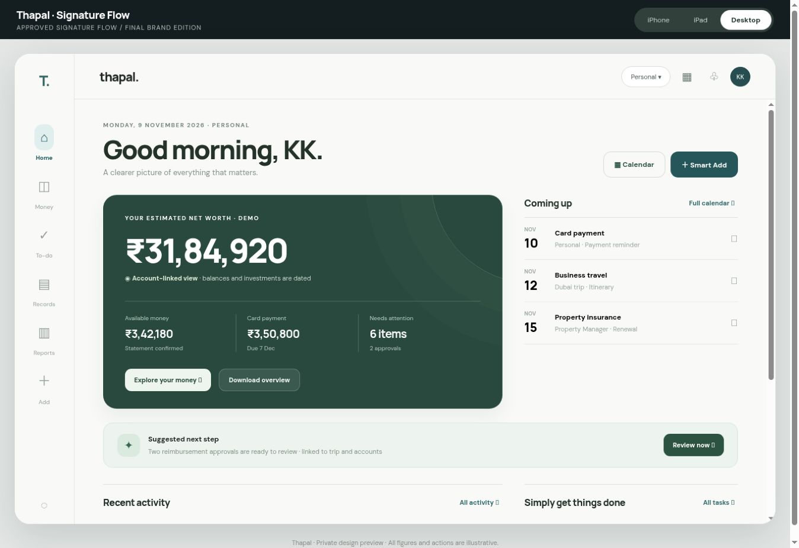
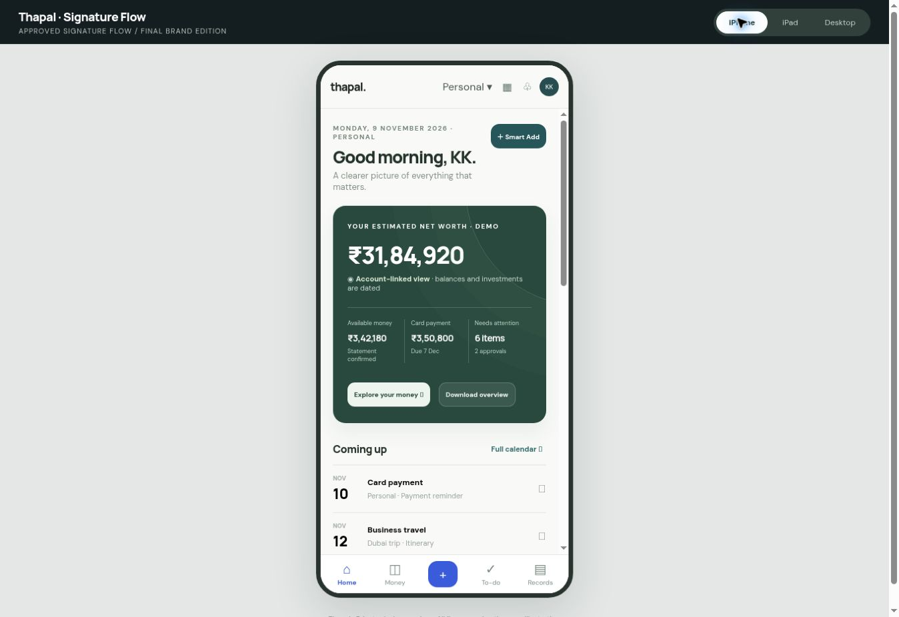
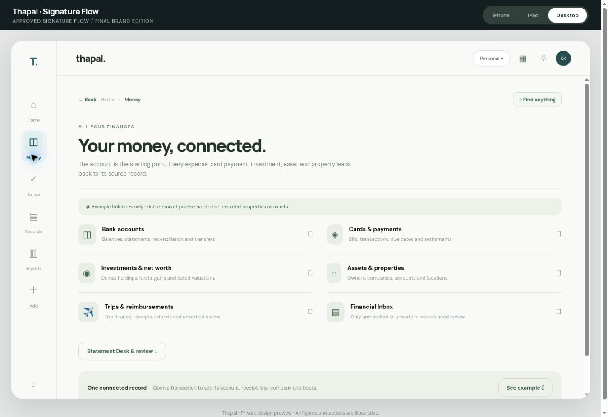
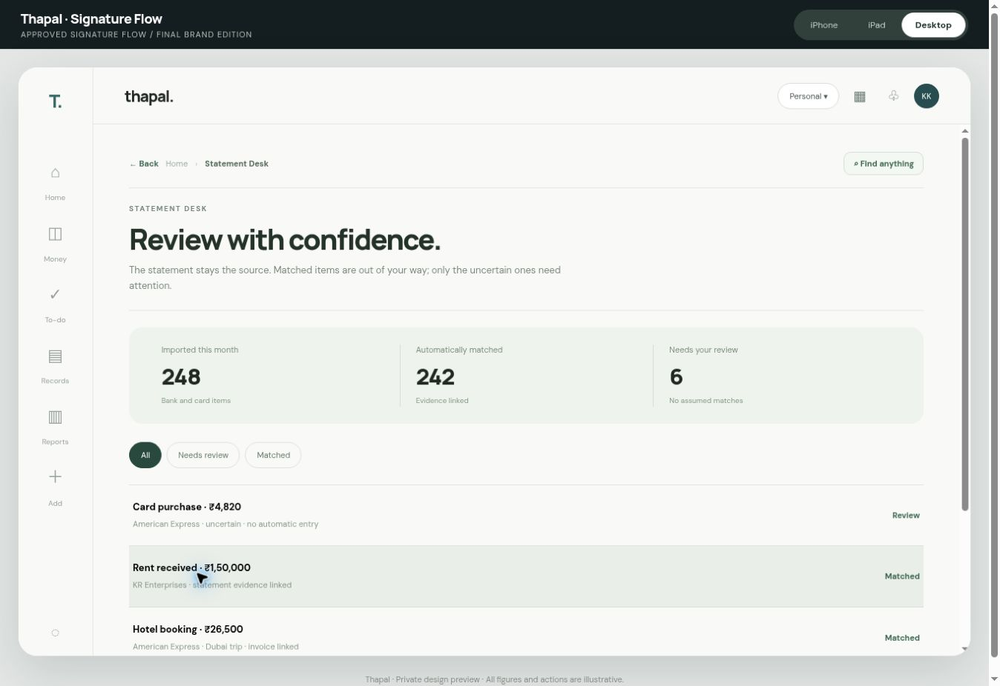
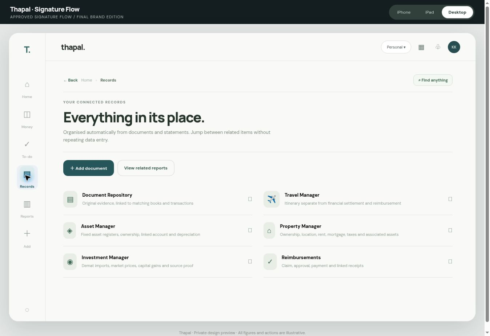
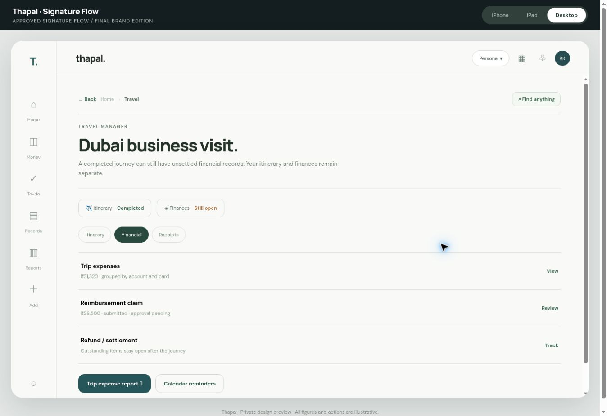
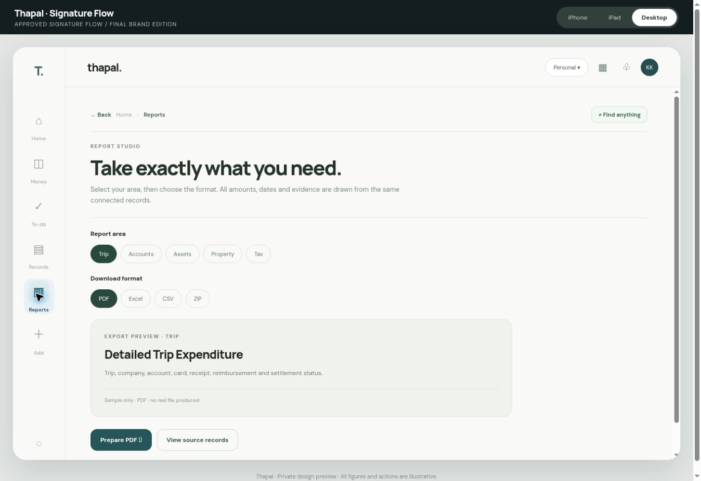
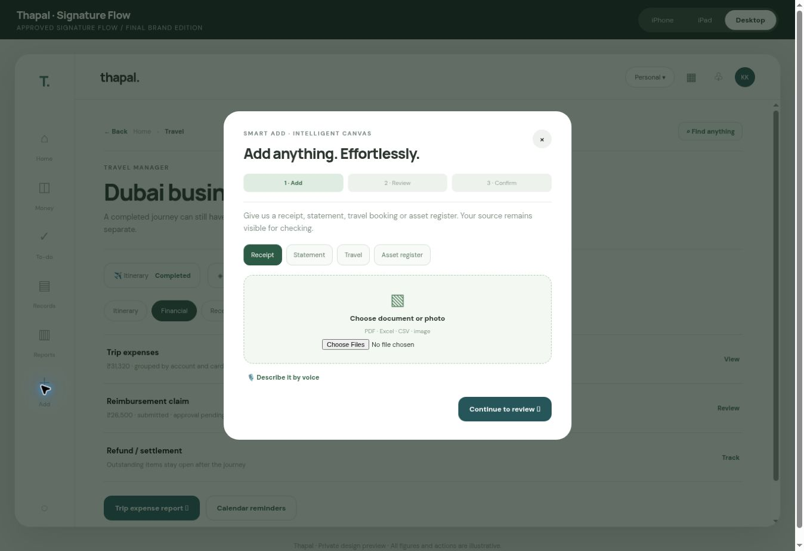
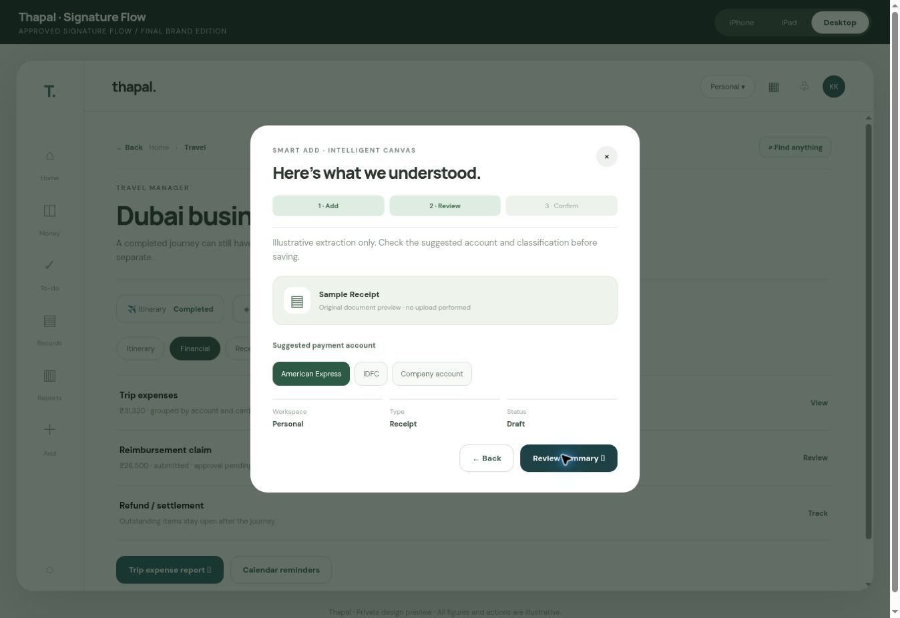
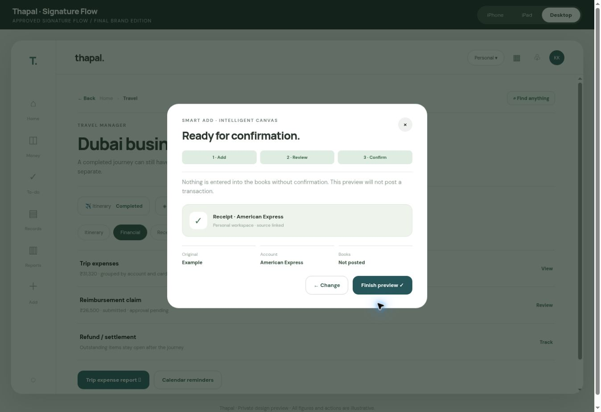

<!-- Converted unchanged (pandoc) from KK's upload Thapal_V4_Standalone_Complete_UIX_Signature_Flow.docx on 9 Nov 2026. Images: docs/evidence/signature-flow-reference/ (rIdNN.png names map: rId20=01 … rId73=10). Authority: UIX contract read alongside THAPAL V4 Final 1; it does not replace V4 (its own §19.1). -->
# Thapal Signature Flow Complete UIX and Interaction Master

**Final design handoff for Claude and the engineering team**  
**Approved visual concept:** Signature Flow, Concept 06  
**Owner:** KK  
**Document version:** UIX standalone V4 alignment draft — 9 November
2026  
**Design approval:** KK rated the direction 10/10. This is approval of
the design direction, not of production code or financial accuracy.

> **Use and source note:** This is the standalone UIX and design-flow
> authority for the Thapal development team. It carries forward KK’s
> approved Signature Flow Concept 06 and all 111 numbered screens. The
> full **THAPAL V4 Final 1** was reported as shared with Claude but was
> not available as an attached or accessible source in this
> document-generation session. This document therefore aligns with the
> available V3/V3.1 and known V4 decisions; Claude must run and report a
> line-by-line V4 parity comparison before treating it as exhaustive
> against V4. No UIX implementation, merge, database change or
> publication is authorised by this document.
>
> **Visual truth:** Ten images below are direct screenshots of the
> independently hosted Signature Flow prototype. They are the approved
> design-direction references for the particular screens/states
> displayed; they do not represent 111 completed visual designs.
> Remaining screens must be proposed in the same design language and
> individually reviewed by KK. An earlier iPad capture was inaccurate
> and is deliberately excluded. Brand placeholders in captures
> (`thapal.` and `T.`) must be replaced by the approved capitalised
> **Thapal** identity and the actual Option 02 vector once supplied.

## 1. Executive directive

Figure 1 — Desktop Home, approved Signature Flow prototype

*Figure 1 — Desktop Home, approved Signature Flow prototype. Exact
capture from the separate Signature Flow prototype, with demonstration
values. It is a visual reference, not proof that the production workflow
is functioning.*

Reproduce the approved **Signature Flow** appearance and the natural
**Flow** interaction model faithfully, then implement the full Thapal
system underneath it. This document is the UIX contract, navigation
specification, interaction map, and test plan. It is not permission to
alter production data or deploy a release. Do not redesign the accepted
look; do not substitute a generic dashboard, card grid, accounting ERP,
or another theme. Show working previews at iPhone, iPad, and desktop
sizes throughout development. No functionality is accepted because it
merely looks clickable.

**Design source of truth:** private interactive concept
`https://ledgerline-signature-flow.alertcabin20.chatgpt.site` (legacy
preview URL, now displaying Thapal). The concept is a design study with
**illustrative figures and local-only actions**. `ledgerline.biz` is the
existing live product under its prior name; do not overwrite it, replace
its data, alter its authentication, or publish new code without explicit
approval. Obtain read access to the current codebase and inspect
existing components before changing anything. Preserve the existing
Statement Desk and confirmed accounting rules.

**Non-negotiable outcome:** an exceptionally polished, approachable
financial companion usable by a person who is not an accountant, while
still preserving correct source-linked books, permissions, explanations,
exports, and an audit trail. The app should feel calm, intelligent,
responsive and quietly premium. The visual language is Apple-inspired,
never an imitation of Apple’s protected assets.

## 2. Authority and traceability

The following are distinct and must not be conflated:

1.  **Approved visual direction:** Signature Flow, 10/10 preference.
2.  **Observed prototype behavior:** navigation, selected module
    screens, illustrative Smart Add steps, tabs, search suggestions,
    device preview toggles.
3.  **Required production behavior:** the detailed implementation
    specification below; this is a **target**, not a claim about
    completed code.
4.  **Unresolved implementation decisions:** final vector artwork
    production and licensing, fonts licensing, live feeds, regional
    statutory templates, external integration credentials, production
    release approval and device verification. The name **Thapal** and
    minimalist Option 02 logo direction are selected.

Capture screenshots and interaction recordings of the reference at
desktop, iPad and iPhone; freeze them in the design QA baseline. Record
the exact source commit, deployment, browser and date in each
comparison. Do not treat demo numbers, fictional dates, account suffixes
or examples as real records.

## 3. Visual system and tokens

### 3.1 Identity

The Signature Flow visual identity combines the restrained editorial
quality of Signature Edition with Flow’s reassuring hierarchy, guided
next action, universal search and direct navigation. The final approved
product name is **Thapal**—always capital T, lowercase hapal, without a
trailing full stop in the wordmark. The chosen logo direction is
**Option 02: a minimal single-stroke capital T symbol paired with a
clean, contemporary Thapal wordmark**. Use deep forest ink, restrained
typography, exact optical alignment, and excellent readability from a
small app icon to a desktop header. No stacked-paper motif, interwoven
symbol, ornamental frame, decorative ligature, complex emblem, gradient
or shadow. The symbol’s final vector curves, kerning, clear-space and
small-size optical compensation require design QA before release. Apply
this consistently to the sign-in screen, navigation, app icon, document
titles, reports, notification sender, mobile app name, metadata,
onboarding and help content. This is a design and naming decision, not a
verified trademark or domain clearance. No heavy gradients, ornamental
illustrations, glowing cards, neon finance colors or noisy colored
glyphs.

### 3.1.1 Final logo production contract

- **Approved direction:** Option 02, minimalist T plus modern sans-serif
  Thapal. Do not reopen creative directions without KK’s instruction.
- **Capitalization:** always **Thapal** in UI, reports, email subject
  lines, notifications, document footers, metadata, app store copy and
  legal-facing product references. Never `thapal`, `THAPAL`, `Thapal.`
  or `T.` as the full name. The standalone app-icon symbol may be a
  simple T.
- **Master artwork:** deliver original editable SVG/vector outlines and
  editable text-layout source, with dark-on-light, light-on-dark,
  monochrome and icon-only exports. Verify exact spelling, licensed
  typeface and legibility at 16, 24, 32, 48 and 128 px.
- **Placement:** the symbol may appear in the rail/app icon; the
  wordmark appears in the top bar and sign-in screen. Keep baseline, cap
  height, clear space and sizes consistent across devices. Do not invent
  a tagline.
- **Acceptance:** compare the final artwork in the real Signature Flow
  header at iPhone, iPad and desktop widths, plus splash/sign-in,
  notification icon and reports. No clipping or visual overpowering of
  the content. Any non-trivial logo refinements require KK review before
  production.

### 3.2 Reference palette

The prototype CSS contains these reference values. These are starting
tokens to be normalized and tested, not a claim that every screen
already uses them perfectly.

| Token            | Reference | Application                                            |
|------------------|-----------|--------------------------------------------------------|
| Ink              | `#222923` | Primary text and icon strokes                          |
| Muted            | `#778178` | Support text and secondary labels                      |
| Soft             | `#F5F5F0` | Quiet secondary surfaces                               |
| Line             | `#E7E8E1` | Hairlines and row separation                           |
| Deep             | `#223B35` | Premium primary actions and emphasis                   |
| Mint             | `#D3E8DC` | Rare positive or contextual accents                    |
| Copper           | `#AD7756` | Restrained warm brand detail                           |
| App canvas       | `#FBFBF8` | Main content background                                |
| Preview surround | `#E7E9E5` | Prototype frame only; not the actual mobile app chrome |

### 3.3 Design rules

- Use a systematic 4-point spacing grid: 4, 8, 12, 16, 20, 24, 32, 40,
  48 and 64. Default desktop page inset 32–40 px, tablet 24–32 px,
  iPhone 16–20 px, adapted for safe areas.
- Large editorial welcome heading, restrained uppercase overline, one
  prominent financial number, supporting metrics, thin separators,
  mostly flat rows and selective soft surfaces.
- Set font family by a confirmed licensed web-safe/system stack.
  Prototype uses Manrope in places; document the chosen production
  families and loading fallbacks. Use tabular numerals for money; align
  currency and decimal precision consistently. Support Tamil and Hindi
  fallback glyphs where enabled.
- Define text roles: hero 36–44 px desktop / 28–34 px phone, page title
  26–32 / 24–28, section title 17–20, body 14–16, support 12–14,
  overline 10–12. These are design targets; tune against reference
  captures and accessibility zoom.
- Minimum ordinary touch target 44 × 44 CSS px, visible keyboard focus,
  contrast at least WCAG AA for normal text, semantic controls,
  reduced-motion support, readable 200% zoom and dynamic text sizing.
- Icons must be one coherent outline family in consistent 20/24 px
  optical boxes with accessible labels. Replace placeholder Unicode
  symbols in production with licensed, consistent vector icons. The
  specific user-facing meaning must never rely on color alone.
- Use restrained 160–240 ms motion for direct manipulations and 240–320
  ms for panels. No unnecessary animation; honor
  `prefers-reduced-motion`.
- Avoid giant nested cards. Use typography, space, subtle lines and
  occasional muted backgrounds to establish hierarchy. Avoid decorative
  boxes around every number.
- Maintain logical visual rhythm: back controls, title, description,
  filters, content, secondary links, bottom safe-area spacing. Keep
  actions in the same relative place across similar modules.

## 4. Device-specific composition

Figure 2 — iPhone-mode Home, actual prototype simulation

*Figure 2 — iPhone-mode Home, actual prototype simulation. Exact capture
from the separate Signature Flow prototype, with demonstration values.
It is a visual reference, not proof that the production workflow is
functioning.*

| Dimension          | iPhone                                                                                                                                                       | iPad                                                                              | Desktop                                                                  |
|--------------------|--------------------------------------------------------------------------------------------------------------------------------------------------------------|-----------------------------------------------------------------------------------|--------------------------------------------------------------------------|
| Primary navigation | Persistent 5-item bottom navigation: Home, Money, Add, To-do, Records; Reports and deeper modules reached by search, contextual links and More/Records index | Adaptive sidebar or split navigation; selected detail remains visible beside list | Slim persistent left rail, visible context/header and wide content pane  |
| Primary action     | Center Add remains immediately available, outside keyboard overlap                                                                                           | Add button in header/rail and contextual actions                                  | Add in rail/header and contextual content                                |
| Content            | One meaningful column; no horizontal scroll; safe-area insets                                                                                                | Two columns where valuable, three only when legible                               | Two-column editorial Home and contextual panels; maximum readable widths |
| Home hierarchy     | Greeting, net-worth headline, next action, metric stack, upcoming, activity, quick links                                                                     | Greeting + net worth across width; next step beside activity/calendar             | Signature wealth summary, Coming up, single priority and quiet lists     |
| Lists              | Full-width tap rows, large hit targets, detail pushed full-screen                                                                                            | List/detail split, persistent selection                                           | Spacious list/detail or content panel                                    |
| Smart Add          | Full-height sheet with camera/files, sticky next action, accessible dismissal                                                                                | Modal/split sheet showing original and extracted data                             | Wide original-vs-intelligent-fields canvas                               |
| Search             | Full-screen command search, keyboard opens only after user taps search                                                                                       | Overlay/palette, result grouping                                                  | Command palette with keyboard shortcut and contextual quick results      |

On iPhone test compact and large widths including 320, 375, 390, 430 CSS
px and landscape; real physical iPhone Safari must be tested. On iPad
test 768, 820, 1024, 1180 widths, portrait/landscape and Split View. On
desktop test 1280, 1440, 1728 and narrow resizable windows. Breakpoints
are implementation details; content usability is the acceptance
criterion. Do not simply scale down a desktop mockup.

## 5. Navigation architecture

### 5.1 Global navigation

**Primary destinations:** Home, Money, To-do, Records, Reports. **Global
utilities:** Smart Add, Calendar, Notifications, Search, Workspace
switcher, Profile/Settings, Help. On iPhone Reports may sit under
Records/More but must remain reachable within two clear taps from Home.
A user can search by person, merchant, amount, document, trip, company,
asset, property or report. Show results grouped by domain, with source
and workspace labels.

**Back behavior:** every module and detail has a predictable Back
control that returns to the prior location with scroll/filter preserved.
Breadcrumbs on desktop/iPad are compact and accurate to the real
navigation path; do not show `Home > detail` when the user actually came
from Reports. Browser back/forward and deep links must work. Closing a
modal returns focus to its opening control and must not erase unsaved
work silently.

**Workspace switcher:** Personal, Family, Company, Trust, plus
configured organizations. Always display the active workspace and
permissions. Changing it refreshes all relevant data; never leak data
across workspaces. Optionally allow a combined authorized personal
overview but label entity ownership for every value. A user with
multiple companies can select individual company, entity group or
approved consolidated view.

### 5.2 Canonical route map

| Top route        | Children and deep links                                                                                                    |
|------------------|----------------------------------------------------------------------------------------------------------------------------|
| `/home`          | Next action, Money overview, calendar item, activity detail, Smart Add, universal search                                   |
| `/money`         | Accounts, bank account, credit card, transfers, payments, loans, cash, investments, net worth, reconciliation              |
| `/tasks`         | Inbox, Smart Review, approvals, missing sources, reconciliation exceptions, reminders, review history                      |
| `/records`       | DocuRepo, Statement Desk, expenses, transactions, Travel, Reimbursements, Assets, Property, Investments, entities/projects |
| `/reports`       | Catalogue, builder, filters, previews, export jobs, download history and evidence packs                                    |
| `/calendar`      | Month/agenda, item detail, source record, reminders, linked external calendar                                              |
| `/notifications` | Activity, grouped alerts, actions, preferences                                                                             |
| `/add`           | Smart Add → Intelligent Canvas → source confirmation → Statement Desk authoritative intake → linked result                 |
| `/search`        | Global results → authorized record/detail/command                                                                          |
| `/settings`      | Profile, workspaces, organizations, bank/payment methods, integrations, roles, security, accessibility, language, exports  |

Every child route needs loading, empty, populated, error, unauthorized,
stale data, offline, unsaved draft, and success states where applicable.
For every deep link, breadcrumbs and return target must be correct.

## 6. Complete screen inventory and contracts

Each numbered screen below is required. Claude must produce a
screen-by-screen implementation checklist, not merely create the five
navigation tabs. Individual subpages may share reusable templates but
must still have purposeful fields, states and actions. Every displayed
figure links to its authoritative source, has a valuation/as-of date
where needed and does not imply false accuracy.

**Total coverage: 111 explicitly identified screens or functional
subpages** across 11 areas. This is a traceability inventory, not a
proposal to clutter the navigation with 111 menu entries. Claude must
map each ID to a route or purposeful modal/panel, a reusable layout
archetype, an authoritative data source, the allowed actions,
empty/error/review states, a responsive screenshot and its end-to-end
tests. Every ID must be marked Implemented, Partial, Missing, Blocked or
Not applicable with evidence; none may be silently omitted.

| Area                       | Screen IDs  | Count   | Main visual / interaction pattern                                             |
|----------------------------|-------------|---------|-------------------------------------------------------------------------------|
| Onboarding and access      | A01–A06     | 6       | Calm step-based setup; original vs extracted documents; progress and recovery |
| Home and universal         | B01–B08     | 8       | Editorial Home, global search, calendar, notifications, workspace context     |
| Money and accounts         | C01–C12     | 12      | Account-first index/detail, transaction evidence, money and liabilities       |
| Inbox and Statement Desk   | D01–D10     | 10      | Attention queue, source-vs-parsed comparison, match and exception review      |
| Expenses and Smart Add     | E01–E11     | 11      | Full source-visible Intelligent Canvas and draft-to-confirmation journey      |
| DocuRepo and organizations | F01–F09     | 9       | Document viewer, relationship panel, entity master and projects               |
| Travel and reimbursements  | G01–G11     | 11      | Trip tabs, itinerary versus finance status, claim and settlement              |
| Investments                | H01–H08     | 8       | Holdings lists, dated prices, tax lots, net-worth composition                 |
| Assets and property        | I01–I10     | 10      | Registers, property detail, ownership and valuation paths                     |
| Reports and statutory      | J01–J14     | 14      | Scope builder, preview, background export, professional close                 |
| Settings and trust         | K01–K12     | 12      | Plain-language settings, integration health, scoped roles and recovery        |
| **Total**                  | **A01–K12** | **111** | **Each screen receives desktop, iPad and iPhone acceptance evidence**         |

### A. Onboarding and access

**A01 Welcome and Sign in.** Clean brand mark, Google sign-in, secure
session states, terms/privacy links, account recovery; no intrusive
marketing. **A02 Workspace setup.** Select personal, family,
organization or trust; add organization by uploading registration
documents; extracted values previewed and confirmed with cited document
fields. **A03 Invite and access.** Owner, member, preparer, reviewer,
verified accountant, auditor read-only; invitation, expiration,
revocation, grants and role explanation. **A04 Setup progress.** Import
sources, confirm account ownership, choose accounting period, unfinished
setup recovery. **A05 Opening balances.** Source-backed schedules,
validation and unresolved opening differences. **A06 Welcome tour.**
Short optional, skippable, never blocks core work.

### B. Home and universal tools

**B01 Home:** Signature header and personalized greeting; estimated net
worth with as-of label; cash, investments, cards, pending counts;
priority/next best action; upcoming events; recent transactions; quiet
shortcuts to Statement Desk, Travel, Records and Reports. **B02 Global
search:** category-grouped results, recent records, natural-language
query and direct routes; keyboard activation intentional. **B03 Calendar
month and agenda:** due dates, premiums, subscriptions, trips, document
expiry, approvals, tax deadlines, loan EMIs and property events; each
event opens its linked source. **B04 Calendar item:** details, owner,
source, reminder schedule, recurrence, snooze and external calendar sync
status. **B05 Notifications center:** grouped actionable notices,
severity, unread/read, mark all, snooze, thresholds and destination.
**B06 Notification preferences:** per type/channel/workspace and quiet
hours. **B07 Workspace selector:** account/entity boundary, accessible
switch and confirmation of unsaved work. **B08 Global command/help:**
Find anything, voice-to-text with transcription review, context help and
shortcut discovery.

### C. Money, accounts and financial operations

Figure 3 — Money hub and account entry points

*Figure 3 — Money hub and account entry points. Exact capture from the
separate Signature Flow prototype, with demonstration values. It is a
visual reference, not proof that the production workflow is
functioning.*

**C01 Money overview:** separate verified cash, cards,
receivables/payables, loans, investments, assets and liabilities;
net-worth calculation must avoid double counting. **C02 Bank account
index** and **C03 Bank account detail:** masked identifiers,
institution, account owner, source freshness, running balances,
statement history, transaction list, reconciliation state and account
reports. **C04 Credit card index** and **C05 Card detail:** statement
cycle, posted vs pending, due date, minimum/total due, linked payments,
unmatched items and installment details. **C06 Transaction detail:**
source line, attachments, original amount/currency, classification,
entity, merchant, linked invoice, trip/property/asset, audit history,
split and reviewer decision. **C07 Transfer and card payment review:**
from/to accounts, third-party distinction, duplicate protection, linked
debit/credit, reversals and reconciliation; no fake expense on card
payment. **C08 Loans and EMIs:** lender, liability, schedule,
principal/interest breakdown, collateral, upcoming due and statements.
**C09 Cash and wallet accounts:** opening balance, movements and
reconciliation. **C10 Net worth:** dated composition, group/entity
boundaries, pricing freshness and transparent inclusions/exclusions.
**C11 Recurring payment manager:** detection, confirmation, future cash
requirements, reminders and cancellations. **C12 Account settings:**
owner/company mapping, permissions, sync, historical import, currency
and export.

### D. Financial Inbox and Statement Desk

Figure 4 — Statement Desk review entrance

*Figure 4 — Statement Desk review entrance. Exact capture from the
separate Signature Flow prototype, with demonstration values. It is a
visual reference, not proof that the production workflow is
functioning.*

**D01 Financial Inbox overview:** grouped pending action by workspace,
account, entity and importance, not an unbounded raw import list. **D02
Smart Review:** review queues with bulk select and select all within
explicit scope; confidence and source reasons, safe approve/reject/undo.
**D03 Statement Desk intake:** preserve the existing authoritative
statement-centric entry model. Upload PDF/CSV/XLSX/image statement,
choose/create account, detect source period, show extracted lines and
balances, deduplicate, then stage. **D04 Statement comparison:**
original document visibly beside parsed lines; opening/closing balance
proof, chronology, running totals, missing lines, currency and
duplicates. **D05 Match suggestions:** possible
invoice/bill/receipt/transfer matches, confidence and reason, no reuse
of a single invoice for duplicate debits, no forced match of partial
payments. **D06 Account reconciliation:** opening + credits – debits =
closing, differences, bank fees/interest, source gap and independent
check. **D07 Transfers and Card Payments queue:** precise two-sided
linking and third-party exceptions. **D08 Review history:** who changed
what, before/after, evidence, time and undoability. **D09 Background job
progress:** imports survive navigation/reload; resumable, retryable and
cancellable where safe; never pretend work completed. **D10 Exception
resolution:** missing statement, suspicious duplicate, unclear merchant,
partial payment, unmatched invoice, unauthorized import and conflicting
owner.

### E. Expenses and intelligent intake

**E01 Universal Expense entry:** Smart Add or optional accessible quick
correction, not an accountant-heavy form; voice, photo, upload,
email-forward and share sheet when supported. **E02 Smart Add source
selection:** choose file/camera/voice/drag-and-drop, batch indicator,
supported formats, clear privacy notice. **E03 Intelligent Canvas
extraction:** original source permanently visible, suggested vendor,
amount, date, taxes, currency, payment account, category, entity,
project/trip/property/asset, reimbursement and confidence. **E04 Canvas
exception/duplicate review:** side-by-side evidence and candidate links;
edit, split, defer, assign, reject, clear reason; user can inspect
source field crop. **E05 Canvas confirmation:** explicit proposed
changes, destination and effects; user approves only safe authorized
actions. **E06 Draft and processing history:** where the file went, job
status, corrections, failures, duplicate handling, and undo. **E07
Expense list:** fast search, filters, bulk category, grouped activity
and download. **E08 Expense detail:** original evidence and all
accounting links. **E09 Income/receipt detail:** bank source, payer,
invoice and tax status. **E10 Merchant/category rules:** suggestion
review, history, merge preview and undo. **E11 Splits and
multi-currency:** allocation by amount/percentage, precision, exchange
source/date and stale exchange flag.

### F. Documents and organizations

Figure 5 — Records, the repository entry point

*Figure 5 — Records, the repository entry point. Exact capture from the
separate Signature Flow prototype, with demonstration values. It is a
visual reference, not proof that the production workflow is
functioning.*

**F01 DocuRepo index:** folder-free search plus filters by entity,
record type, date, ownership and expiry. **F02 Document viewer:**
PDF/image/spreadsheet preview, extracted text, source metadata,
versions, access, linked records and immutable original. **F03 Document
relationship view:** one source to accounts, expenses, trips, assets,
property, accounting entries, report and audit trail. **F04 Document
requests:** missing evidence request, assignee, due date and permission.
**F05 Documents lifecycle:** replacement, superseding, retention,
deletion permission and audit. **F06 Company/entity index:** group
relationships, legal identity, tax registration, owners and mapping.
**F07 Company profile:** document extraction, legal names, period, bank
accounts, staff roles, statutory status and contacts. **F08
Projects/activities:** linked expenses, budget, reimbursement and
detailed statement. **F09 Contact/merchant directory:** deduplicated and
ownership scoped.

### G. Travel and reimbursements

Figure 6 — Travel workspace

*Figure 6 — Travel workspace. Exact capture from the separate Signature
Flow prototype, with demonstration values. It is a visual reference, not
proof that the production workflow is functioning.*

**G01 Travel Manager index:** trips grouped by upcoming, active,
completed, with independent financial status. **G02 Trip overview:**
destination, dates, purpose, travelers, owning workspace, itinerary
status and financial settlement status. **G03 Itinerary:** flights,
accommodation, transport, meetings, documents, schedule and calendar.
**G04 Trip budget:** planned vs committed vs spent, by
currency/entity/account; compact, never double count credit card
payment. **G05 Trip expenses:** source-linked payments, allocations and
account/card filters. **G06 Travel receipts:** original invoices and
booking proof. **G07 Reimbursement claim:** original expense reference,
policy, claimant, submitted/approved/paid status. **G08 Approval and
payment:** who can approve, separation of duties, bank settlement and
partial payment. **G09 Refund and trip closing:** track cancellations,
refunds, open card settlements and outstanding claims independently of
completed itinerary. **G10 Trip report and evidence:** detailed
expenditure statement, traveler/role, company, account, dates, currency,
settlement and PDFs/CSV/XLSX. **G11 Trip collaborator settings:** roles,
privacy, approvals and change log.

### H. Investments and net worth

**H01 Portfolio overview:** holdings by demat/provider, asset class and
owner. **H02 Import statements:** ICICI Direct and other supported
brokers, equities, mutual funds, gold, distributions, corporate actions
and opening holdings. **H03 Holding detail:** units, cost lots,
transactions, market price/as-of, income, realized/unrealized gain,
evidence and stale-data badge. **H04 Valuation history:** authoritative,
licensed/available feed, provider provenance and last update; never
invent ‘live’ when delayed/stale. **H05 Capital gains and corporate
actions:** splits, bonuses, dividends, transfers and tax lots. **H06
Manual market-rate fallback:** explicit manual source and stale
indicator. **H07 Net worth reconciliation:** bank + investments +
property/asset ownership + liabilities with consolidation adjustments
and no duplicate asset book-value/market-value inclusion. **H08
Portfolio reports:** positions, holdings, flows, realized gains and
source pack.

### I. Assets and property

**I01 Asset register:** entity, classification, code, acquisition date,
cost, funding account, location, custodian and status. **I02 Asset
detail:** invoices, ownership, depreciation method/life, accumulated
depreciation, impairment, maintenance, transfers and disposal. **I03
Asset import review:** Excel/PDF register extraction, duplicate
detection and approval. **I04 Depreciation working:** books vs tax
methods, dates, reversals and change history. **I05 Asset
disposal/transfer:** gain/loss, buyer, sale evidence, account settlement
and no silent deletes. **I06 Property index:** owner, property, group,
rental/operating status. **I07 Property detail:** deed,
acquisition/funding, valuation date, linked loan, rent receipts,
tenants, occupancy, insurance, tax and maintenance. **I08 Property cash
flow:** rent, expenses, dues, loan and account reconciliation. **I09
Property calendar:** renewal, tenancy, tax, insurance and compliance.
**I10 Asset/property relationship:** associated equipment mapped to
buildings without double counting the property plus component assets.

### J. Reports, tax and statutory work

Figure 7 — Reports entry point

*Figure 7 — Reports entry point. Exact capture from the separate
Signature Flow prototype, with demonstration values. It is a visual
reference, not proof that the production workflow is functioning.*

**J01 Report studio:** discover via global search,
entity/account/trip/property/period selectors and saved configurations.
**J02 Report preview:** clear scope, totals, source links, provisional
badges and validation status. **J03 Export dialog:** PDF/XLSX/CSV/ZIP,
date range, currency, entity, included evidence and redaction. **J04
Export jobs and history:** background generation, retry, completed
download integrity/hash, access and expiry. **J05 Personal reports:**
cash flow, spending, income, budget, debts, recurring, net worth,
investments and tax prep. **J06 Business books:** general ledger, trial
balance, balance sheet, P&L, cash flow, journal, vouchers and period
close. **J07 Account reports:** statements, reconciliation, credit card
and outstanding. **J08 Expenses/projects/travel:** detailed expenditure,
budget variance, reimbursement settlement and evidence. **J09
Assets/property/investments:** registers, depreciation, rental
statements, gains, holdings, valuations and source packs. **J10 Tax
working center:** statutory calendar, classification, drafts,
source-linked schedules, professional review and sign-off. **J11
India-specific reporting templates:** GST, TDS/TCS, income tax and
Companies Act as applicable to each entity, period and currently
verified rules. **J12 Malaysia/multi-jurisdiction scope:** activate only
for entities with applicable profiles; rules and formats must be
verified separately. **J13 Period close and audit readiness:**
reconcile, unresolved exceptions, opening schedules,
accruals/prepayments, reversals, lock/unlock permissions and evidence
pack. **J14 Regulatory monitor:** provenance, effective date, change log
and professional-approval gates. Never auto-file or claim regulatory
conformity without a verified template and approval.

### K. Settings, integrations and trust

**K01 Settings home:** clear categories, account/workspace context.
**K02 Accounts and payment methods:** linked account management, import
permissions and mapping. **K03 Organization and ownership:** company
group, personal/family/trust, relationships, accounting period and
currency. **K04 Roles and accountant grants:** invitation, identity
recheck, scoped access, expiry, revoke and full log. **K05
Integrations:** bank feeds, demat, document storage, email, calendars,
notifications, WhatsApp/share sheet where permitted, with connection
health and graceful fallback. **K06 Import and automation rules:**
explain/approve merchant classifications, recurrence and matching
thresholds. **K07 Accessibility and language:** font sizing, contrast,
reduced motion, language and voice entry. **K08 Security:** Google
sign-in, sessions, MFA where supported, revocation and activity. **K09
Data and recovery:** export, backups, restore drills, deleted-document
recovery, retention and legal holds. **K10 Release/version
information:** environment, build, service health and known limitations.
**K11 Support/help:** plain-English glossary, context help, error
reporting and guided recovery. **K12 Privacy and consent:** sensitive
document handling, scopes, audit history and deletion policy.

## 7. Core cross-module data connections

| Source / event                   | Authoritative destination                  | Linked surfaces                                                          | Guardrails                                               |
|----------------------------------|--------------------------------------------|--------------------------------------------------------------------------|----------------------------------------------------------|
| Bank/card statement line         | Statement Desk, account ledger             | Money, Inbox, transaction, reconciliation, Reports                       | Independent balance proof, dedupe, no invented match     |
| Receipt / bill / invoice         | DocuRepo original + staged expense/invoice | Intelligent Canvas, account, trip, project, asset/property, tax, reports | Source immutable, edits versioned, no unapproved posting |
| Card payment / internal transfer | Linked debit and credit across accounts    | Card dues, Money, reconciliation, cash flow                              | No double count as spending; third-party distinction     |
| Travel booking                   | Trip itinerary record                      | Calendar, Docs, trip expense only when payable/posted                    | Itinerary completion ≠ financial settlement              |
| Reimbursement                    | Claim linked to exact incurred expense     | Approval, payable, bank settlement, report                               | No duplicate expense; role checks                        |
| Demat statement / market price   | Investment lots and valuation service      | Investments, net worth, gains, reports                                   | Dated prices, provenance, stale flag                     |
| Company documents                | Entity master + DocuRepo                   | Settings, accounts, tax, reports, permissions                            | Extract + confirm; entity boundary enforced              |
| Asset/property acquisition       | Fixed asset/property ledger + source       | Money, loans, depreciation, locations, net worth                         | Ownership, valuation basis, consolidation safeguards     |
| Reminder/deadline                | Calendar event with source ID              | Home, Notifications, account/trip/property/tax                           | Deep link, recurrence, timezone, notification choice     |
| Period close                     | Ledger snapshot + linked evidence          | Reports, auditor, reconciliation, recovery                               | Approval, lock, audit trail, restore test                |

All records require stable IDs, entity and workspace ID,
owner/permissions, source document IDs, account IDs when applicable,
timestamps, status, version and actor. Preserve transaction-level
provenance across imports and corrections. Build one canonical financial
calculation layer; never calculate Home, report and detail totals
separately. Use idempotency keys for imports, payment matching, exports
and background jobs.

## 8. Complete interaction flows

### Flow 1 — First-time setup with document extraction

Sign in → select/create workspace → upload company registration /
identity and bank sources → OCR and extraction → show originals
alongside suggested fields → user confirms or corrects → create
organization and account mappings → import opening schedules → run
validation → show Setup complete **only when** authoritative records
meet requirements → Home with source freshness. No compulsory manual
retyping where a document contains a reliable value; always allow safe
correction and exceptions.

### Flow 2 — Daily financial review

Home priority → To-do → Financial Inbox → Statement Desk → select
account and period → compare original lines with parsed transactions →
see matched/unmatched → inspect possible duplicates and partial payments
→ approve a valid match or leave unresolved → account reconciliation →
updated Money totals → Review History. A duplicate bank debit cannot
reuse an invoice; a short payment remains partially outstanding;
unmatched charges stay exceptions.

### Flow 3 — Smart Add and Intelligent Canvas

Figure 8 — Add source

*Figure 8 — Add source. Exact capture from the separate Signature Flow
prototype, with demonstration values. It is a visual reference, not
proof that the production workflow is functioning.*

Figure 9 — Review source

*Figure 9 — Review source. Exact capture from the separate Signature
Flow prototype, with demonstration values. It is a visual reference, not
proof that the production workflow is functioning.*

Figure 10 — Confirm proposed action

*Figure 10 — Confirm proposed action. Exact capture from the separate
Signature Flow prototype, with demonstration values. It is a visual
reference, not proof that the production workflow is functioning.*

Any module Add button → choose source (camera, Files, share sheet,
voice, drag-drop) → local preview and upload/progress → document
classification → extracted fields with clickable source evidence →
account/entity/trip/project suggestions → duplicate and currency checks
→ user correction or defer → explicit confirmation with effect (draft,
link, post only if authorized) → authoritative Statement Desk intake if
it contains statement lines → source-linked receipt/expense and review
history → return to originating context. If OCR uncertain, never fake a
field. If offline, queue visibly and reconcile after connection. A long
upload remains recoverable after navigation. Record canceled/rejected
drafts without contaminating books.

### Flow 4 — Travel lifecycle

Records → Travel → new trip from booking → itinerary/calendar →
estimated budget → link receipts and card/bank lines → allocate to
company/project → submit reimbursement → approve/pay claim → await
refund/card settlement → detailed expenditure report and evidence ZIP →
mark finance complete independently. Trip completion must never silently
close pending refunds or claims.

### Flow 5 — Assets, property and net worth

Upload purchase deed/invoice/register → extract owner, location,
acquisition amount and account → reconcile payment and depreciation
rules → attach asset to property if relevant → valuation with
date/source → net-worth inclusion review → report. If a piece of
equipment is embedded in property value, the consolidation rule must
prevent counting both market/property value and the same component
separately.

### Flow 6 — Investment import and valuation

Upload demat statement → parse holdings and tax lots → reconcile
opening/closing quantity and cash transactions → source-linked portfolio
→ refresh permitted market data with timestamp → stale/unavailable badge
when necessary → net-worth summary and report. Never say ‘live’ merely
because a prior close is displayed.

### Flow 7 — Reports and period close

Enter Report Studio from source module or global menu → choose entity,
account, date and format → preview scope and unresolved items → request
export → background job progress → download and integrity verification →
optionally include evidence pack → accountant reviews tax/period-close
schedules → controlled sign-off/lock. An export failure keeps the job
retryable; no fake success toast.

### Flow 8 — Calendar and notifications

Account/trip/property/recurring payment creates due event → Home Coming
up and Calendar show event → user taps date or notification → direct
destination and relevant record → snooze/reschedule with permission →
sync external calendar if authorized → clear sync status. Notification
tap must not lead to a generic unrelated page.

### Flow 9 — Permissions, recovery and continuity

Owner grants scoped accountant role → recipient verifies identity → sees
authorized workspace and record only → action creates audit entry →
owner revokes → access ceases across tabs and downloads. Interrupted
upload/reconciliation/export resumes safely without duplication. Backups
and restore are tested in isolated environment before release.

## 9. Screen-level states and writing tone

For all screens build skeleton loading, successful loading, empty state
with next useful action, partial/stale data, offline, permission denied,
recoverable error, irrecoverable failure, and saved draft when relevant.
Use plain-English labels: “Needs your review”, “Matched to statement”,
“Couldn’t read this line”, “Choose an account”, “Saved as a draft”. Keep
technical accounting vocabulary behind accessible explanation; do not
hide professional detail from accountants. Never use “100% accurate”,
“guaranteed”, “all done”, or “live” unless evidence supports it.

Money formatting: Indian digit grouping for INR; local currency symbol,
ISO code when ambiguity exists; negatives, zero and refunds visually
clear; never truncate important decimals. Distinguish balances, dues,
available cash, investments, asset values, liabilities, cash flow and
net worth. Use consistent success/warning/error treatments with text and
icons. Every source-derived displayed value needs an as-of/source state.

## 10. Acceptance testing matrix

These are **mandatory release tests**, not proof they already passed.
Each test must have an ID, device/browser, steps, expected result,
actual result, screenshot/video, build, owner and resolution. No
severity 1 or 2 defects at approval. Test on production-like anonymized
seed fixtures; no live financial changes.

| ID     | Journey / quality gate                   | Required result                                                                                                       |
|--------|------------------------------------------|-----------------------------------------------------------------------------------------------------------------------|
| UX01   | Visual comparison on every screen        | Typography, spacing, alignment, icon family, colors and hierarchy match approved baseline within documented tolerance |
| UX02   | iPhone narrow/large and real Safari      | No clipping, horizontal scrolling, keyboard overlap or obstructed actions; safe area and dynamic type correct         |
| UX03   | iPad portrait, landscape and Split View  | Purposeful split layout, no desktop squeeze, controlled overflow                                                      |
| UX04   | Desktop keyboard navigation              | Full focus order, visible focus, Enter/Escape, browser back, deep links and screen-reader labels                      |
| UX05   | Reduced motion / contrast / 200% zoom    | Usable without motion, readable, no hidden controls                                                                   |
| NAV01  | Every primary and secondary route        | Correct entry, destination, breadcrumbs, Back and preserved filters/scroll                                            |
| NAV02  | Global search                            | Finds modules and records without cross-workspace leakage; handles zero results and stale data                        |
| NAV03  | Workspace switching                      | Correct data scope, totals refresh and unsaved-work warning                                                           |
| ADD01  | Single receipt through Smart Add         | Preview, extraction, correction, account/entity linking, source preservation, confirmation and correct final state    |
| ADD02  | Batch PDF, photo, CSV and XLSX           | Formats classified, individual failures recoverable, duplicates caught                                                |
| ADD03  | Cancel, close, Escape and resume         | No orphan modal, data loss or accidental posting; opening control regains focus                                       |
| ADD04  | Voice-to-text and correction             | Consent, transcript preview, correction, appropriate fallbacks and no false recording claim                           |
| STM01  | Independent bank statement balance proof | Printed opening, credits, debits and closing reconcile without circular use of invoice data                           |
| STM02  | Duplicate debit and partial payment      | Duplicate invoice match blocked; outstanding invoice balance maintained                                               |
| STM03  | Missing bank fee/unmatched invoice       | Both shown as unresolved exceptions, never invented                                                                   |
| STM04  | Long-running import, reload and retry    | Job persists and resumes without duplicate postings                                                                   |
| FIN01  | Transfer and credit card settlement      | Both account sides linked, no new spending counted for card payment                                                   |
| FIN02  | Net worth with properties and assets     | No component duplication; valuation source/date visible                                                               |
| TRV01  | Completed itinerary, open finance        | Reimbursement/refund/card balance remains open until settled                                                          |
| TRV02  | Trip reporting                           | Accounts, currencies, expenses, receipts and claims reconcile to source                                               |
| INV01  | Demat upload and corporate actions       | Holdings/units/cost lots reconcile; stale market data disclosed                                                       |
| RPT01  | PDF/XLSX/CSV/ZIP reports                 | Correct scope, formatting, totals, evidence and byte-integrity; jobs retry safely                                     |
| TAX01  | Regulatory template and close            | Current rule source, review status, professional approval and period lock enforced                                    |
| SEC01  | Cross-workspace/role permissions         | No unauthorized data/API/export access; revoked access terminates                                                     |
| SEC02  | Recovery and backup restore drill        | Verifiable recovery with audit trail and no duplicate financial events                                                |
| PERF01 | Home, Money, Inbox and Expenses          | Target meaningful ready state ≤2 s in agreed network/device test profile                                              |
| PERF02 | Statement Desk                           | Target meaningful ready state ≤2.5 s; long tasks explicitly backgrounded                                              |
| REL01  | Preview vs intended release              | Exact commit, tests, migration plan, rollback and deployment parity recorded                                          |

### 10.1 Prototype audit evidence and limits

**Observed/checked in a previous interactive prototype QA pass:** Home
and Money navigation, non-Home Back/Find-anything control, Smart Add
step 1 → step 2 → account selection (IDFC) → step 3, not-posted
confirmation wording, and closing Smart Add. A close-control issue was
found and repaired, then dismissal was retested. JavaScript syntax check
passed on the acceptance overlay. This covers **selected illustrative
behaviors only**. It is not a full iPhone-device test, accessibility
audit, API test, real OCR test, export verification, bank reconciliation
test or production security audit.

**Static-source audit observations:** source uses an inherited
single-page prototype with screens overridden by several JS layers,
placeholder Unicode icons, hard-coded sample totals/dates, demo
`notice()` dialogs for certain actions and local-only file selection.
Several modules use generic detail layouts. The production rebuild must
consolidate overrides into clear components and real routes while
preserving its appearance. Notable potential concerns to verify: a
report action’s interpolated template text, modal dismissal and focus
restoration beyond the specific close test, file-name rendering
sanitization, semantic keyboard controls, actual responsive behavior on
hardware and correct route history. Do not certify these as passed
without fresh tests.

## 11. Engineering implementation instructions for Claude

1.  **Audit before editing.** Inventory
    routes/components/schema/services; compare to this matrix and
    earlier Thapal requirements, marking Done / Partial / Missing /
    Blocked with evidence. Identify user-modified code and preserve it.
    Do not replace Statement Desk, accounting history or permissions
    just to make the UI easier.
2.  **Create the design system.** Freeze tokens, typography, icons,
    common page header, sidebar, bottom nav, breadcrumbs,
    empty/loading/error states and modals. Use a component library that
    does not alter visual identity. Screenshot comparisons precede
    broader rollout.
3.  **Implement all inventory pages.** Build them in connected vertical
    slices: shell + Home → accounts/Statement Desk → Smart Add →
    travel/reimbursements → investments/assets/property → reports/close
    → settings/security. Reuse elements but do not leave blank
    placeholder screens.
4.  **Bind authoritative records.** Use stable entity/account/source
    IDs, server-side authorization and one calculation layer. Keep
    demo/mock fixtures in preview only. Every write records provenance
    and approval status.
5.  **Separate safe automation from consequential approval.** Automate
    extraction and suggestions; require explicit authorized confirmation
    for uncertain financial decisions, professional sign-off and
    statutory filing.
6.  **Test every journey at each slice.** Unit, integration,
    accessibility, visual regression and end-to-end tests must use
    seeded fixtures with adversarial cases. Maintain a defect log and
    screen-by-screen coverage report.
7.  **Protect the current release.** Development and QA in
    preview/staging. Database migrations reversible and backed up.
    Publish only after explicit KK approval with exact commit, release
    notes, screenshots, test evidence and rollback.

### 11.1 Required Claude output after each implementation cycle

- Screens built, changed and not touched; exact routes and preview link.
- Difference from the Signature Flow baseline with before/after iPhone,
  iPad and desktop captures.
- User journeys executed, counts of passing/failing tests and raw
  evidence paths.
- Source records connected, authorization checks and any synthetic/mock
  data still visible.
- Bugs fixed, known limitations, migration impact and rollback route.
- Current status by all screen IDs A01 through K12, plus blockers and
  next iteration.
- A clear separation between ‘implemented’, ‘automated test passed’,
  ‘physically device-tested’, ‘compliance reviewed’, and ‘approved for
  production’.

## 12. Approval and release gate

KK’s **10/10** is the approved aesthetic target. Production approval
requires all critical journeys, all mandatory pages, iPhone experience,
security and accounting correctness to be verified. Collect visual
acceptance on actual iPhone, iPad and desktop; demonstrate Smart Add
with real yet safe sample documents; demonstrate independent
reconciliation, reports and roles; verify release parity. If any screen
is absent or any figure unreliable, mark it **not ready**. Do not infer
success from a passing unit-test count or a beautiful preview.

**Final handoff instruction to Claude:** “Build Thapal to this exact
Signature Flow UIX specification, preserving the established live
application’s source of truth. First return a screen/route/feature gap
audit and a phased preview implementation plan; then implement and prove
each journey. Do not deploy to production or touch live records without
explicit approval. Never present mock interactions as completed
functionality. Treat visual excellence, iPhone usability, provenance,
auditability, accessibility, data correctness and recoverability as
simultaneous acceptance conditions.”

## 13. Universal interaction anatomy for every page

The same page anatomy applies across the 111 screen IDs, with density
adapted to device and role:

1.  **Context:** active legal entity or Personal/Family/Group context,
    page title, succinct explanation, provenance/as-of date.
2.  **Orientation:** Back returns to the precise originating page,
    selected tab, scroll position and filters. Deep links and browser
    Back work. Breadcrumbs appear when useful on larger screens; a
    simple labelled Back suffices on iPhone.
3.  **Primary action:** one meaningful next step; supporting actions
    live in a consistent action menu. Dangerous actions use an explicit
    confirmation and show financial consequences.
4.  **Content:** flat, readable rows, meaningful group headers, no
    stacked generic cards; labels understandable to a non-accountant.
5.  **Source relationship:** amounts open details; details open their
    source document and accounting entry where authorised; report values
    open the filtered underlying records.
6.  **State:** skeleton/loading, populated, empty with help,
    stale/partial, permission denied, offline, save pending, recoverable
    failure, blocked, completed and history. Do not show a success state
    before durable confirmation.
7.  **Accessibility:** logical focus, visible keyboard selection,
    announced live changes, 44px targets, 200% zoom, plain-language
    errors, reduced motion and language-aware rendering.

### Shared components and exact behaviour

| Component          | Entry and response                                                                                                            | Required edge cases                                                                                   |
|--------------------|-------------------------------------------------------------------------------------------------------------------------------|-------------------------------------------------------------------------------------------------------|
| Workspace switcher | Personal, own family shares, companies, trusts, configured group; current scope visible at all times                          | Warn of unsaved draft; clear stale data, cache and search on switch; never leak former scope          |
| Universal Search   | User taps icon or uses shortcut; group permitted results by account, transaction, document, trip, person, property and report | Do not auto-open keyboard on unrelated screens; permission and empty results; query retained on Back  |
| Calendar           | Home icon opens month/agenda; event opens exact originating module record, not a dead generic event                           | Overdue, recurrence, multiple owners, all-day/time-zone, snooze, privacy of ICS titles                |
| Notifications      | Group by entity, due date and consequence; tap goes to source with a contextual action                                        | Failed delivery, deduplication, read/unread sync, revoke, quiet hours                                 |
| Global Add         | One reusable camera/files/drag/drop/voice/share/email entry, all feeding Statement Desk                                       | Batch, multi-page join, multi-document split, background resume, unsupported file, malware, duplicate |
| Intelligent Canvas | Original beside extracted data on wide screens, switchable source/data on phone                                               | Field confidence, source crop, mixed currencies, edit/defer, offline, conflicting owner, cancel       |
| List/detail        | Select row; preserve filter and scroll; detail opens split pane on iPad/desktop and full page on iPhone                       | Very long values, multi-select/select-all scope, sorting, empty/error, responsive overflow            |
| Safe action menu   | View, edit draft, replace, split, link, duplicate check, share, export, cancel, delete where allowed                          | Posted history never erased; correction uses reversal; undo reason and audit log                      |
| Money amount       | Tap opens account, event, posting, evidence, reconciliation, linked modules                                                   | Source date, stale estimated/confirmed status, negative/refund, exchange-rate precision               |
| Export             | Format, scope, source/evidence options, preview, durable progress and verified download                                       | Retry, permission expiry, large file, checksum, redaction and data period                             |

## 14. Module-to-module navigation and data relationship map

Each arrow represents both a useful navigation path and a record
relationship, **not an invitation to duplicate financial postings**.

| Starting view    | Navigate to                                                     | What carries across                                  | Return behaviour                   |
|------------------|-----------------------------------------------------------------|------------------------------------------------------|------------------------------------|
| Home net worth   | Money → Net worth → Holding/account/property                    | Active scope and valuation-as-of                     | Back to Home at same scroll        |
| Home next action | To-do → specific unresolved record                              | Workspace, task ID, account, priority                | Return to same To-do selection     |
| Bank transaction | Statement Desk → Source → Match → Expense/Invoice               | Transaction ID, amount, account, confidence          | Back to original bank row          |
| Card payment     | Card → transfer pair → bank account                             | Both debit/credit IDs; one settlement effect         | Retain both accounts and cycle     |
| Expense          | Paying card/account → trip/project → company → reimbursement    | One expense ID with separate payer and beneficiary   | Breadcrumb and action panel        |
| Company profile  | Accounts → Books → GST/Tax → documents → reports                | Legal-entity ID and accounting period                | Company context remains fixed      |
| Trip             | Itinerary → receipts → budget → claims → settlement → Trip Pack | Permanent trip ID; separate itinerary/finance states | Trip active tab preserved          |
| Property         | Title → tenant/lease → rent bank row → loan → asset → report    | Permanent property ID and owner                      | Return to selected property        |
| Asset            | Invoice → payment → depreciation → maintenance → disposal       | Permanent asset ID, location, funder                 | Return to exact register filter    |
| Investment       | CAS/broker source → lot → bank flow → valuation → gains/tax     | Owner, holding ID, tax lots, market data date        | Return to owner portfolio          |
| Tax report       | Draft → figure → book posting → original source → review        | Entity, period, rules version, proposed status       | Back to exact line in draft        |
| Calendar event   | Original loan/trip/tax/property/insurance item                  | Source ID, owner, due date                           | Return to calendar date            |
| Notification     | Exact due/review item                                           | Notification and originating source IDs              | Back to notification list          |
| Document         | Every linked record and reported figure                         | Immutable source ID/version                          | Back to document and prior filters |

### A critical accounting distinction

The UI must label financial statuses honestly: **Estimated, Source
confirmed, Reconciled, Reviewed, Filed, Paid and Locked** are different.
No report or screen may state that an alert-driven bank balance is
confirmed, that a tax draft is filed, or that a credit-card settlement
is an expense. Consolidated group totals must identify owner and
elimination rules. Permanent readable IDs use the **individual company
or personal accounting scope**, not merely the current login owner, as
reaffirmed in the reported V4 decision DN-P2-IDS.

## 15. Detailed interaction journeys and alternate paths

### Journey A — First ten minutes

Sign-in → choose Personal/company/trust/family account → Add
registration or statement → file preview → extraction suggestions →
resolve only unknown owner/account/period → setup progress → first Money
view → To-do for missing evidence. A returning user resumes from the
exact unfinished step. No manual company-registration form should be the
default; show extracted official fields with their original source
beside them. An account without validated opening balance must remain
provisional.

### Journey B — Daily money review

Home → Coming up/Needs attention → To-do grouped by owner and risk →
transaction or source → explanation and candidate match → approve,
split, reject or defer → independent statement reconciliation → Money
totals and reports refresh. A duplicate debit cannot consume the same
bill twice. A partial payment leaves the open amount. Every review
action supports history and safe undo where permitted.

### Journey C — Smart Add from every screen

Tap Add in Home, an expense, a trip or an asset → source choice →
immediate original preview → durable upload job → read and classify →
Intelligent Canvas with source evidence and account/owner/trip
suggestions → duplicate and tax checks → correct/confirm/defer → visible
outcome in its original module and the corresponding To-do/Books/Records
links. Cancel does not post. Re-upload of same original cannot create a
second financial event. Batch files stay separately traceable while a
multi-page single document remains one record.

### Journey D — Travel and reimbursement

Forward booking → create Trip ID and calendar → itinerary → budget →
card/bank-linked expenses → payer versus beneficiary entity → claim and
independent approver → partial bank settlement → refund waiting →
separate finance and travel status → PDF/Excel/CSV/ZIP Trip Pack. Show
claimant, approving entity and bank evidence; do not close money merely
because the journey ended.

### Journey E — Investment and net worth

Upload CAS/demat → broker and owner matching → lot movements and
corporate actions → bank cash flows → source-dated closing/NAV prices →
realised/unrealised gain → liabilities and group elimination → net-worth
view → tax and holding reports. If a provider fails, display
Stale/Unavailable and last successful date; never invent live
valuations. The iPhone view must show the same essential evidence one
level at a time.

### Journey F — Property, assets and projects

Upload deed/invoice/contractor bill → owner, permanent
property/asset/project ID → bank funding, loan and evidence → project
cost head/CWIP if applicable → location and maintenance → depreciation
and tax treatment → rentals/insurance/tenant if applicable → valuation
and reports. Asset and property must not double count building fixtures.
Deletion of posted assets or holdings becomes controlled
disposal/reversal, never silent destruction.

### Journey G — Business books and compliance

Upload invoice/bill or raise a sales invoice → customer/vendor →
entity-specific accounting → GST/TDS rule and evidence → bank
receipt/payment → reconciliation → journal and reports → compliance
working → professional review → export/file through approved method →
acknowledgement and payment evidence. Distinguish preparing, reviewing,
filing and paying; opening a report line must show the underlying
calculation and original document.

### Journey H — Family and professional access

Switch to another adult’s family scope only when shared →
invitation/role scope → identity verification → access granted with
expiry → view and propose within the grant → owner approve where needed
→ revoke immediately → audit history. A user cannot see another person’s
private records simply because they are family, manager or finance
staff. Lost access while a page is open must terminate searches, exports
and detail access correctly.

### Journey I — Offline, failure and recovery

Document added offline → visible queue → network restored → idempotent
resume → duplicate check → original preserved → success with source
reference. OCR failure shows why and allows retry/manual upload;
notification failure does not affect accounting; export failure
preserves job ID; provider prices become stale; restored files/entries
keep permanent IDs and never re-post. The user can always find
unfinished items in To-do or processing history.

## 16. Additional V4 functional areas that need UIX placements

These are not extra primary navigation tabs. They belong within the 111
parent screens and may contain legitimate child pages, drawers or
reusable details. Claude must expand the screen register if a separate
route is required rather than hiding an untracked screen.

| V4 functional area               | Parent UIX destination                       | Required child interaction                                                               |
|----------------------------------|----------------------------------------------|------------------------------------------------------------------------------------------|
| Company secretary and governance | Records → Entity; Reports → Compliance       | Registers, meetings, resolutions, filing task, evidence, CA/CS approval                  |
| Trusts and 80G                   | Records → Trust; Reports → Tax               | Donations, donor identity, receipts, registers and verified forms                        |
| Sales invoices and payables      | Money and Records → Transactions; Reports    | Create/preview/send, credit notes, ageing, payment evidence, tax links                   |
| Payroll import                   | Records → Company; Money → Payables          | Salary register upload, fields and exception review, statutory liabilities               |
| Insurance                        | Records → Policies; Calendar                 | Policy detail, nominee, premiums, renewal, claims, no inflated net worth                 |
| Forex and LRS                    | Money → Currencies; Reports → Tax            | Wallet/card, remittance, FX rate, tax credit, stale source                               |
| Estate readiness                 | Records → Personal                           | Nominees, document inventory, restricted sharing and emergency access                    |
| Construction and projects        | Records → Projects                           | Cost head, certified bills, line-item evidence, CWIP and variance                        |
| Email intake                     | Add → Integrations; Records → Intake history | Forwarding addresses, consent, connected status and failed import                        |
| Notices and appeals              | To-do and Records → Compliance               | Notice, owner, due date, response draft, submissions and evidence                        |
| AIS/Form 26AS                    | Reports → Personal Tax                       | Government statement comparison, unmatched amounts, draft review                         |
| Ask Thapal                       | Search / Help                                | Source-grounded answer, scope label, report jump, “I can’t verify”                       |
| Monthly Money Letter             | Home / Reports / Notifications               | Period summary with dated figures and one-click source links                             |
| Automation quality               | Settings → Automation; To-do                 | Accuracy by field, issuer, format, exceptions and no-touch rate                          |
| Money Map                        | Money                                        | Grouped map on wide displays, one-level drilldown on iPhone, accessible list alternative |
| Completion and Health Centre     | To-do / Settings / Reports                   | What is current, provisional, missing, overdue, blocked and verified                     |

## 17. Responsive device-specific screen contracts

**iPhone.** Bottom navigation: Home, Money, central deep-green Add,
To-do, Records. Reports within two taps via Records or global search.
One column; fixed safe-area bottom actions; search keyboard only on user
action; details full-screen with contextual Back. Smart Add is a
full-height sheet with camera/files and persistent Continue. Source
inspection must not hide extracted fields permanently; a source/data
toggle or step navigation is acceptable if faithful to approved concept.

**iPad.** Adaptive sidebar and split view with list/detail persistence.
No enlarged phone-only interface. Support portrait, landscape and Split
View. Source PDF/image stays alongside extracted fields where space
allows. Calendar, investment holdings, Travel and Money Map use real
tablet density. No iPad layout counts as approved until a correct
prototype capture and physical test are available.

**Desktop.** Narrow rail and wide content; Home’s net worth and Coming
up relationship follows Figure 1. Source/data Canvas side by side,
global command search, right detail panes, report builder, bulk review
and keyboard shortcuts. Respect narrow browser windows, 200% zoom and no
horizontal overflow of financial totals.

## 18. Screen acceptance and visual review protocol

For each ID A01–K12, produce an audit row with: route; entry source;
title; purpose; screen design screenshot at iPhone/iPad/desktop; active
workspace; data contract; action and secondary menus; destination links;
all relevant states; permission/role; keyboard/screen-reader evidence;
unit/integration/end-to-end test; exact V4 requirement IDs; visual
approval by KK; version/commit. **Eight fully built screens in Claude’s
earlier code audit are not assumed visually approved.** Remaining
partial/missing screens remain open even when a generic component
renders them.

Visual review must include a side-by-side actual capture versus the
corresponding approved prototype image where one exists. Check brand,
font, button hue, grid and baseline, icons, title size, whitespace, safe
areas, scrolling, overlay positioning, focus restoration, motion,
dark/low-light and high-contrast modes if offered. For screens without
approved captures, generate a candidate in the same system, label it
**proposed**, and ask KK to approve. Do not use conceptual diagrams as
evidence of exact UIX appearance.

Functional review must follow actual user actions, including permission
denial, failed provider, duplicate import, split payment, refund,
partial claim, empty onboarding, stale market feed and 20,000-row batch
if relevant. Log defects by severity and screen ID. A 10/10 user design
rating does not mean production release approval.

## 19. Claude execution and delivery contract

1.  Read this UIX master alongside THAPAL V4 Final 1 and report every
    difference, missing V4 module, newly required route and approval
    conflict. **Do not silently substitute this document for V4.**
2.  Map all 111 screen IDs to current route/component and mark
    Implemented, Partial, Missing, Blocked with code, screenshot and
    test proof. Compare with existing Gate 1 evidence.
3.  Freeze the Signature Flow component library, token system, brand and
    navigation shell before mass page rollout. Preserve and reuse
    functioning business logic; do not redesign financial calculations
    in UI files.
4.  Implement vertical slices in an isolated branch/preview: shell;
    Home/Search/Calendar/To-do; Money/Statement Desk; Smart Add/Canvas;
    Records/DocuRepo; Travel/Claims; Investments;
    Assets/Property/Projects; Reports/Compliance; Settings/Access.
5.  Each slice must show all three device compositions, role variations,
    empty/stale/error states, complete back/forward paths, exact source
    links and no duplicate financial effects.
6.  Produce a screenshot contact sheet, route/interaction graph,
    automated and manually tested journeys, screenshot diffs,
    accessibility findings and a list of visual decisions needed from KK
    after each slice.
7.  Do not merge, publish, migrate financial data, grant roles or change
    live DNS without separate explicit KK approval. Physical iPhone/iPad
    checks and hosted integration verification are distinct release
    gates.

**Approval statement:** Signature Flow visual direction is approved.
Individual unshown pages, final Option 02 SVG, actual mobile/tablet
rendering, accounting integrity and production deployment are not
automatically approved.

## Appendix A — Design reference pages presently demonstrated

**Direct prototype surfaces:** Home, Money, To-do, Records,
Reports/Report Studio, Calendar, Notifications, Account, Transaction,
Statement Desk, Travel Manager, Assets, Property, Investments,
Documents, Reimbursements, Smart Add/Intelligent Canvas, workspace
selection and command search. The term ‘surface’ is intentional: several
are illustrative templates, not the complete child pages enumerated
above.

**Prototype design features to preserve:** editorial greeting, estimated
net worth with dated/provenance note, compact supporting metrics,
priority panel, Coming up linked events, recent activity, direct search,
persistent navigation, fluid source-linked rows, restrained color,
connected-record language, workflow tabs (Statement Desk, Travel and
Reports), account/workspace awareness, and three-step Smart Add preview.

## Appendix B — Definitions

**UIX:** visual interface, screen hierarchy, navigation, interaction,
feedback and accessibility together. **Statement Desk:** authoritative
bank/card statement intake and review entry point. **DocuRepo:**
original evidence and document relationship store. **Intelligent
Canvas:** source-visible extraction, matching, exception handling and
confirmation workspace. **Financial Inbox:** attention management and
exception review; not a second independent source of transactions.
**As-of:** the date/time and provider/source of a balance, rate or
valuation. **Authoritative close:** approved ledger and evidence state
for a period, not merely a downloaded PDF.
